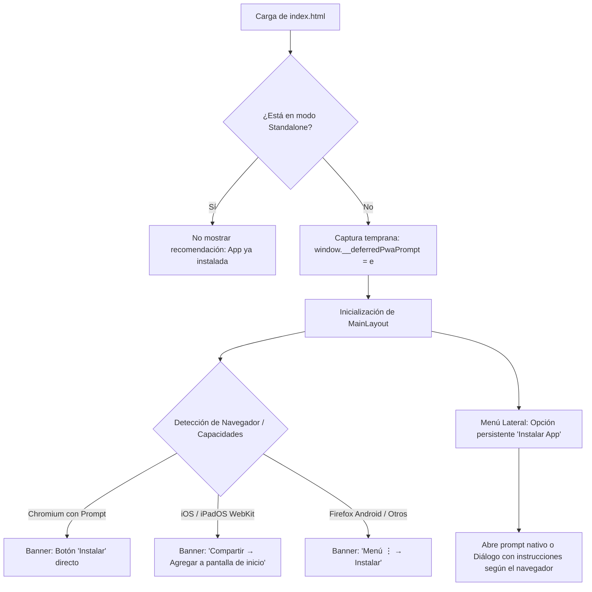

# PWA / Offline — 2026-09-18

Service Worker en modo `InjectManifest` (`quasar.config.ts workboxMode InjectManifest`). Archivos fuente `src-pwa/`.

## Implementado (2026-09-18)

| Aspecto | Archivo | Detalle |
|---------|---------|---------|
| Precaching de assets | `custom-service-worker.ts` | `precacheAndRoute(self.__WB_MANIFEST)` — JS/CSS/imgs + `cleanupOutdatedCaches()` + `skipWaiting()+clientsClaim()` |
| Cache de API (lecturas) | `custom-service-worker.ts` | `StaleWhileRevalidate` `GET /api/v1/core/*` `core-api-cache` |
| SW no intercepta OAuth | `custom-service-worker.ts:54` | `NavigationRoute denylist [/^\/oauth2/,/^\/login/,/workbox-.*\.js$/]` (2026-08-30 fix `200` en `/oauth2/authorization/google`) |
| SW cache limpieza logout | `custom-service-worker.ts` + `store/index.ts` | `postMessage CLEAR_API_CACHE` desde SW scope (no `caches.delete` main thread, 2026-08-29) |
| Manifest cache-busting | `quasar.config.ts` | `extendManifestJson ?v=Date.now()` por icono (2026-08-29) |
| Viewport + safe-area | `index.html` + `app.scss` + `MainLayout` | `viewport-fit=cover` siempre (2026-09-18) + `env(safe-area-inset-bottom)` en `mobile-bottom-nav` y `pymeq-tour-popover` |
| Banner offline | `MainLayout.vue` | `q-banner` `v-if="!online"` `role=alert` + chip `cacheado` + `última sync: HH:mm es-PA` + `lastSync` 30s poll + notify `Conexión de vuelta — datos al día` (2026-09-18) |
| Offline no logout | `src/boot/axios.ts` | `isOffline+isNetworkError` no borra sesión, `refreshTokens` early-return `!navigator.onLine`, `pymeq_last_sync` en cada response OK (2026-09-18, avoids metro logout) |
| Actualización disponible | `MainLayout.vue` + `register-service-worker.ts` | Auto `SKIP_WAITING` silencioso → `controllerchange` → reload (sin dialog, 2026-08-29) |
| Iconos + manifest | `src-pwa/manifest.json` + `public/icons/` | standalone, 15 PNGs regenerados desde `pymeq-app-icon.svg` + SVG any, `theme-color #08090D` |
| Nginx/Caddy SW/SVG | `nginx.conf` + `Caddyfile` | `location ^~ /sw.js` `no-cache` + `path_regexp \.svg$` `no-cache` para SW/SVG/HTML (2026-08-27, Cloudflare purge) |

> **2026-08-11 — Fix PWA sw.js** (ver histórico): `sw.js` excluido de `.js immutable 1y` con `^~` → `no-cache`.
> **2026-08-27 — SVG no-cache** + **2026-08-29 — postMessage** + **2026-08-30 — denylist oauth2** + **2026-09-18 — viewport-fit + offline-fix** todos verificados `npm run build` PWA 924KB.

## Flujo offline (2026-09-18)

1. Online: JWT en `localStorage` + `pymeq_last_sync` update por cada `api` response OK
2. SW cachea `GET /api/v1/core/*` con `StaleWhileRevalidate` → offline sirve cache + banner `datos desactualizados · última sync HH:mm`
3. Sin red: writes fallan con `OFFLINE` (`ERR_NETWORK`/`!navigator.onLine`) sin hacer logout; token expira offline → encola, no revoca, reintenta al volver
4. Al volver: `online` event → notify + `lastSync` update → siguiente `GET` refresca SWR

## Backend

Redis `core-api-cache` (core, 5min `@Cacheable`/`@CacheEvict` facturas+productos). Ver `backend/core/docs/CORE.md`. Idempotencia `POST Idempotency-Key` 6h `SET NX` + `pg_advisory_xact_lock` (no duplica retry).

---

## Estrategia de Instalación PWA Multi-Navegador (Agnóstica)

### 1. Diagnóstico del Problema Actual

Al utilizar la aplicación desde navegadores web (como Google Chrome u otros), la recomendación de instalación o banner PWA nunca se mostraba debido a:

1. **Race Condition en `beforeinstallprompt` (Chromium)**:
   - Chrome/Edge emiten el evento `beforeinstallprompt` en el objeto `window` en los primeros segundos de la carga inicial de `index.html`.
   - El listener estaba registrado únicamente en el `onMounted` de `MainLayout.vue` (`/dashboard`).
   - El usuario inicia su navegación en `/` (Landing) o `/#/login`. Al autenticarse y entrar a `/dashboard`, el evento ya se había disparado y perdido. Chrome no lo reemite en cambios de ruta SPA.
2. **Descarte perpetuo en `localStorage`**:
   - `dismissInstall()` fijaba `pwa_install_dismissed = 'true'` permanentemente. Si se tocaba "Ahora no", nunca volvía a ofrecerse.
3. **Falta de soporte agnóstico multi-navegador**:
   - Safari (iOS), Firefox (Android/Desktop) y otros navegadores no implementan `beforeinstallprompt`. Requieren flujos diferenciados con instrucciones claras o acceso bajo demanda.
4. **Iconos del Manifest**:
   - `src-pwa/manifest.json` agrupaba los PNGs como `"purpose": "any maskable"`. Chromium y Android recomiendan separar las entradas `"any"` y `"maskable"` para evitar que el instalador descarte el icono.

---

### 2. Matriz de Comportamiento por Navegador y Plataforma

| Navegador / Plataforma | Soporta Prompt Programático | Mecanismo de Instalación | Flujo de la App |
|------------------------|-----------------------------|--------------------------|-----------------|
| **Chrome / Edge / Brave / Opera / Samsung (Android & Desktop)** | ✅ Sí (`beforeinstallprompt`) | `deferredPrompt.prompt()` nativo | Banner con botón directo "Instalar" + Botón en Drawer |
| **iOS / iPadOS Safari (WebKit)** | ❌ No | Menú Compartir → "Agregar a pantalla de inicio" | Banner con ícono `ios_share` + Diálogo con pasos visuales |
| **Firefox Android** | ❌ No (evento) / ✅ Sí (browser UI) | Menú ⋮ de Firefox → "Instalar" | Mensaje explicativo guiado ("Toca ⋮ y selecciona Instalar") |
| **Firefox Desktop / macOS Safari (Sonoma+)** | ❌ No programático | Menú del navegador / "Archivo → Agregar al Dock" | Guía contextual si el usuario solicita instalar desde el menú |
| **App ya instalada (Cualquier navegador)** | — | Modo `standalone` activo | Ocultar banner y botón de instalación completamente |

---

### 3. Arquitectura de la Solución Agnóstica



---

### 4. Especificación Técnica de Implementación

#### A. Captura Temprana Universal (`frontend/pymes/index.html`)
Garantiza que ningún navegador basado en Chromium pierda el evento `beforeinstallprompt`, sin importar si el usuario entra por Landing, Login o recuperación de contraseña:
```html
<script>
  window.__deferredPwaPrompt = null;
  window.addEventListener('beforeinstallprompt', function(e) {
    e.preventDefault();
    window.__deferredPwaPrompt = e;
    window.dispatchEvent(new CustomEvent('pwa-prompt-ready'));
  });
</script>
```

#### B. Detección y Flujo Multi-Navegador (`frontend/pymes/src/layouts/MainLayout.vue`)
1. **Detección Standalone universal**:
   ```typescript
   const isStandalone = typeof window !== 'undefined' && (
     window.matchMedia('(display-mode: standalone)').matches ||
     (navigator as unknown as { standalone?: boolean }).standalone === true
   );
   ```
2. **Detección de plataformas**:
   ```typescript
   const isIOS = typeof window !== 'undefined' && (
     /iphone|ipad|ipod/i.test(navigator.userAgent) ||
     (navigator.platform === 'MacIntel' && navigator.maxTouchPoints > 1)
   );
   const isFirefoxAndroid = typeof window !== 'undefined' &&
     /firefox/i.test(navigator.userAgent) && /android/i.test(navigator.userAgent);
   ```
3. **Recuperación del Prompt**:
   Al montarse `MainLayout`, si `window.__deferredPwaPrompt` existe, se asigna inmediatamente a `deferredPrompt.value`. También se escucha el evento `'pwa-prompt-ready'`.
4. **Descarte Inteligente con Cooldown**:
   En lugar de bloqueo eterno, `dismissInstall()` almacena un timestamp de expiración (ej. 7 días):
   ```typescript
   function dismissInstall() {
     showInstallBanner.value = false;
     const expireAt = Date.now() + 7 * 24 * 60 * 60 * 1000;
     localStorage.setItem('pwa_install_dismissed_until', String(expireAt));
   }
   ```
5. **Banner Adaptativo**:
   - En Chromium: Texto "Instala PYMEQ para una experiencia más rápida" + Botón "Instalar".
   - En iOS: "Instala PYMEQ: toca Compartir y luego 'Agregar a pantalla de inicio'".
   - En Firefox Android: "Instala PYMEQ: abre el menú ⋮ de Firefox y selecciona 'Instalar'".
6. **Acceso Permanente en Menú Lateral (Drawer)**:
   - Item "Instalar aplicación" (ícono `sym_r_install_mobile`) en el sidebar cuando `!isStandalone`.
   - Si hay prompt disponible (`deferredPrompt`), ejecuta `.prompt()`.
   - Si no hay prompt (iOS, Firefox o desktop), abre un diálogo explicativo rápido con los pasos exactos para ese navegador.

#### C. Estandarización de Iconos (`frontend/pymes/src-pwa/manifest.json`)
Separar entradas PNG para máxima compatibilidad con todos los motores (Chromium, Gecko, WebKit):
- `icon-192x192.png` con `purpose: "any"`
- `icon-192x192.png` con `purpose: "maskable"`
- `icon-512x512.png` con `purpose: "any"`
- `icon-512x512.png` con `purpose: "maskable"`

---

### 5. Plan de Verificación Multi-Navegador

1. **Google Chrome / Edge (Desktop & Android)**:
   - Cargar desde `/login` y acceder al dashboard.
   - Verificar que el banner superior aparece con el botón "Instalar".
   - Al pulsar "Instalar", se abre el diálogo nativo del sistema.
2. **Safari (iOS / iPadOS)**:
   - Cargar la app en Safari.
   - Comprobar que el banner muestra las instrucciones de "Compartir → Agregar a pantalla de inicio".
3. **Firefox (Android)**:
   - Cargar la app y comprobar las instrucciones específicas para el menú de Firefox.
4. **Acceso bajo demanda**:
   - Descartar el banner ("Ahora no").
   - Verificar que en el menú lateral sigue disponible la opción "Instalar aplicación" y es completamente funcional.
5. **Validación Standalone**:
   - Una vez instalada y abierta como PWA, verificar que no aparece ningún banner ni botón de instalación.

