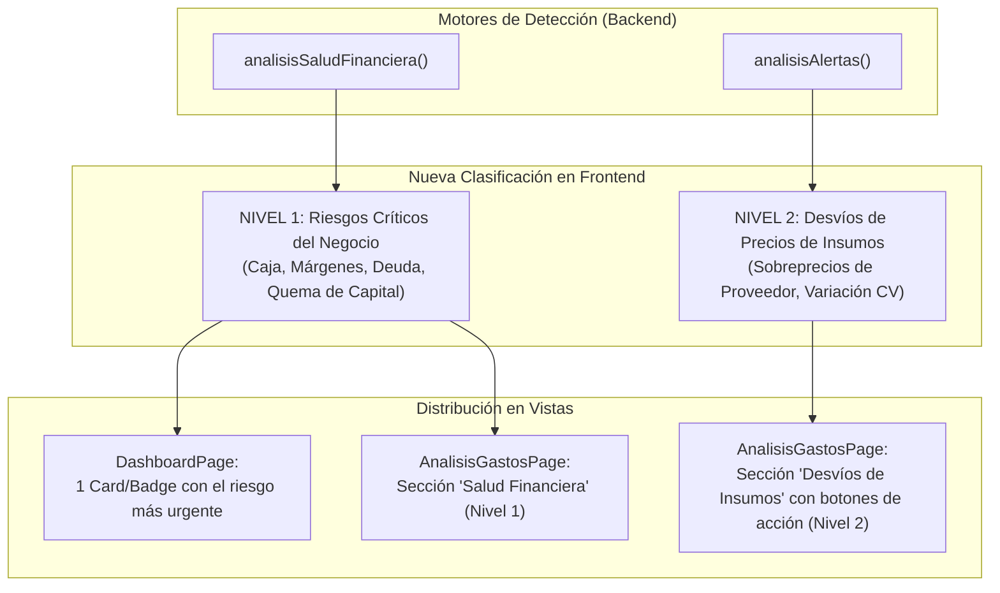

# Estrategia y Plan de Mejora — Sistema de Alertas

**Estado:** ✅ IMPLEMENTADO (2026-11-09) — Ver §7 para las decisiones finales del build.
**Ámbito:** `AlertsPanel.vue`, `FinancialHealthAlerts.vue`, `AnalisisGastosPage.vue`, `DashboardPage.vue`, `ProductosPage.vue`  
**Objetivo:** Unificar y jerarquizar los dos sistemas de alertas existentes, eliminar la duplicidad en la interfaz y dotar a cada alerta de accionabilidad inmediata (resolución en 1 click).

---

## 1. Diagnóstico del Estado Actual

En el MVP coexisten dos motores de detección de anomalías bajo el mismo nombre genérico (**"Alertas"**):

| Motor | Tipo | Origen (`AnalyticsServiceImpl.java`) | Componente UI | Problema Actual |
|---|---|---|---|---|
| **Alertas Operativas** | Insumos / Precios | `analisisAlertas` (CV > 15%, *Supplier Premium*) | `AlertsPanel.vue` | Título "Alertas"; se muestra junto al panel de salud financiera. |
| **Alertas Críticas** | Solvencia / Negocio | `analisisSaludFinanciera` (Margen negativo, costo diario, deuda > 30%, inventario muerto) | `FinancialHealthAlerts.vue` (en `FinancialHealthPanel`) | Título "Alertas"; compite visualmente con el panel anterior. |

### Problemas Clave Identificados:
1. **Sobrecarga Cognitiva y Ambigüedad**: En `AnalisisGastosPage.vue`, ambas cajas de alertas aparecen juntas en la sección `.analysis-vital`. El usuario no distingue qué alerta pone en riesgo la empresa y cuál es un simple desvío de insumos.
2. **Pasividad (Falta de Accionabilidad)**: Las alertas muestran diagnósticos textuales, pero no ofrecen una acción concreta para corregirlos (ej. no enlazan al catálogo, al proveedor alternativo ni a la deuda).
3. **Ausencia de Priorización en Dashboard**: En la pantalla de inicio no existe un semáforo claro que indique si hay algún riesgo existencial activo en el mes.

---

## 2. Nueva Jerarquía de Alertas



---

## 3. Especificación de Accionabilidad (Actionable Alerts)

Cada alerta debe transformar el texto informativo en una acción inmediata:

| Código de Alerta | Mensaje / Diagnóstico | Acción Directa (Botón) | Destino / Efecto |
|---|---|---|---|
| `SUPPLIER_PREMIUM` | *"Proveedor X te cobra +18% sobre el promedio"* | **Ver alternativas** | Muestra los proveedores con mejor precio o navega a Proveedores |
| `PRICE_VARIATION` | *"Variación de precio >15% en compras recientes"* | **Ver historial de facturas** | Abre facturas filtradas por ese producto |
| `DEAD_INVENTORY` | *"Inversión estancada sin compras en 60+ días"* | **Ver productos** | Redirige a `/dashboard/productos` con filtro de inventario |
| `OVER_LEVERAGED` | *"La deuda consume >30% del margen operativo"* | **Revisar préstamos** | Redirige a `/dashboard/prestamos` |
| `SUPPLIER_CONCENTRATION` | *"Proveedor dominante concentra >50% del gasto"* | **Buscar proveedores** | Redirige a `/dashboard/proveedores` |
| `NEGATIVE_OPERATING_MARGIN` | *"Negocio pierde dinero por cada venta"* | **Auditar costos** | Redirige a `/dashboard/costos` |

---

## 4. Cambios Propuestos por Pantalla

### 4.1 `AnalisisGastosPage.vue` y `AlertsPanel.vue`
1. **Renombrar `AlertsPanel`**:
   - Cambiar título de `"Alertas"` a **`"Desvíos en Precios de Insumos"`**.
   - Subtítulo sutil: *"Productos con sobreprecio o variación anormal"*.
   - Badge con conteo y severidad (*warning*).
2. **Acción por Fila en `AlertsPanel.vue`**:
   - Añadir botón de acción rápida al lado del badge de porcentaje:
     ```html
     <q-btn
       flat dense round
       icon="sym_r_swap_horiz"
       color="primary"
       size="sm"
       @click="goToProduct(alert.productId)"
     >
       <q-tooltip>Ver detalle del producto y compras</q-tooltip>
     </q-btn>
     ```
3. **Separación Limpia en el Layout**:
   - Colocar `FinancialHealthPanel` (con las alertas de **Nivel 1 — Riesgos Críticos**) como diagnóstico de salud general.
   - Colocar `AlertsPanel` (con las alertas de **Nivel 2 — Insumos**) en conjunto con la tarjeta de recomendaciones de proveedores (`SupplierRecommendationsCard`).

### 4.2 `DashboardPage.vue`
1. **Pill de Alerta Crítica en el Widget de Salud**:
   - Si existen alertas de Nivel 1, mostrar la más crítica como un pill warning/danger con icono:
     - Ej.: `🔴 Margen Operativo Negativo` o `🟡 Sobreendeudamiento (35%)`.
   - Si no hay alertas de Nivel 1, mostrar badge verde: `🟢 Sin riesgos críticos este mes`.
   - Al tocar el pill, navega directamente a `/dashboard/analisis-gastos`.

---

## 5. Plan de Implementación por Fases

- **Fase 1 (Claridad de Nombres y Estructura)**:
  - Renombrar `AlertsPanel.vue` a "Desvíos en Precios de Insumos".
  - Renombrar `FinancialHealthAlerts.vue` a "Riesgos del Negocio".
  - Reorganizar la grilla de `AnalisisGastosPage.vue` para que no compitan en la misma columna.
- **Fase 2 (Accionabilidad)**:
  - Implementar botones de redirección contextual (`router.push`) en cada ítem de alerta con parámetros de búsqueda/filtro.
- **Fase 3 (Dashboard Integration)**:
  - Conectar el pill de riesgo principal dentro del widget compacto de salud financiera en `DashboardPage.vue`.

---

## 6. Criterios de Aceptación y Verificación

```bash
# Validar linting
cd frontend/pymes && npm run lint

# Validar compilación
cd frontend/pymes && npm run build
```

### Verificación Manual:
1. En **Análisis de Gastos**, no debe haber dos tarjetas tituladas simplemente "Alertas". Una representa "Salud Financiera (Riesgos Críticos)" y la otra "Desvíos en Precios de Insumos".
2. Cada alerta de insumos debe incluir un botón accesible para navegar a la información relevante.
3. En el **Dashboard**, debe existir una indicación visual rápida si el negocio enfrenta un riesgo crítico este mes.

---

## 7. Decisiones finales del build (2026-11-09)

Desviaciones respecto al plan original, elegidas por simplicidad y lenguaje no-técnico:

1. **Fase 1 — tal cual el plan.** Título "Desvíos en Precios de Insumos" + subtítulo "Productos con sobreprecio o variación anormal"; `FinancialHealthAlerts` → "Riesgos del Negocio (N)". Layout: `FinancialHealthPanel` a ancho completo; `SupplierRecommendationsCard` + `AlertsPanel` comparten grid `.analysis-insights` (reemplazó a `.analysis-vital`).
2. **Fase 2 — acción con destino real.** Botón por fila (`sym_r_open_in_new`) → `{ name: 'productos', query: { buscar: productName } }`. `ProductosPage.vue` lee `route.query.buscar` en `onMounted` y pre-carga el buscador (el `watch(search)` carga filtrado; sin doble request). No hay ruta de detalle por producto ni facturas filtradas — destino a la lista ya filtrada es la versión más simple con señal clara.
3. **Fase 2b — barras de precio, cero porcentajes (feedback de usuario: "los % son info avanzada").** El badge `+18%` se eliminó de la fila. En su lugar, dos barras relativas: "Pagaste" (roja/amarilla según severidad; verde si no sobre-paga) vs "Suele costar" (verde), ancho relativo al máximo de las dos. Mensaje concreto en dinero: "Estás pagando B/. 0.90 de más" (`currentPrice - avgPrice`). Imports: `alertBadge` eliminado (muerto), `useNumberFormat` añadido. CSS reutiliza el estilo hardcodeado existente del panel (mismo lenguaje rgba/hex) con `--pq-success/warning/danger` como referencia de tinte; `format-currency` tabular-nums.
4. **Fase 3 — semáforo.** Pill sobre `FinancialHealthPanel` en `DashboardPage` (wrapper `.health-cell` para no romper el grid `dashboard-secondary`): rojo si `code` ∈ {NEGATIVE, OVER_LEVERAGED} (mismo criterio que `FinancialHealthAlerts.alertColors`), amarillo en cualquier otra alerta, verde "Sin riesgos críticos este mes" si no hay alertas. Click → `/dashboard/analisis-gastos`. El pillo verde no es clickeable (nada que revisar). Colores con `color-mix` sobre `--pq-danger/warning/success`.
5. **Fase 3b — sin números en Riesgos del Negocio:** ya se cumple (título + frase de acción, sin métricas); no requirió código nuevo.
6. **Auditoría skills (chart-designer / vue-best-practices / responsive-design):** filas de alerta derivadas a view-model `rows` (template declarativo, cero branch/repeat `toNumber` en template); zona táctil ≥44px en el botón vía `::before`; pill del Dashboard con `href` hash (focusable/tab-ordered, sin `@click`) + `min-height:44px`; escala de barras por fila documentada como `shortcut` (no comparar entre productos: longitudes solo intrínsecas a cada fila — upgrade a escala global si se pide comparar montos absolutos).

No implementado del doc §3 (tabla completa de accionabilidad por código): los destinos específicos por `code` (navegar a proveedores/préstamos/costos) — la tabla sigue siendo referencia para futuras iteraciones; hoy toda alerta de insumo lleva a Productos.

### Actualización 2026-11-11 — alertas con datos reales (reproducción en staging, tenant Mi Rinconcito Criollo)

1. **`DEAD_INVENTORY` → "Productos parados".** Dispara solo con **≥ $50** de capital parado (`shortcut:` piso fijo; el caso real de $26 en 5 productos era ruido presentado como riesgo crítico — configurable por tenant cuando exista esa configuración). Mensaje neutro: "N productos llevan más de 60 días sin compra." (se quitó el falso "inversión alta"). El backend adjunta `items` (id/name/totalInvestment/lastPurchaseDate) con la lista que ya calculaba.
2. **`PAYBACK_RECOVERY` → "Cerraste el mes en pérdida"** + "Gastaste más de lo que vendiste este mes." El `metric = -1` es centinela interno y no se renderiza.
3. **`FinancialHealthAlerts`**: muestra `description` (antes se descartaba) y, para `DEAD_INVENTORY`, el monto parado (`formatCurrency(current)`) y cada producto como botón ≥44px → `productos?buscar=<nombre>` (mismo destino que `AlertsPanel`).
4. **`FinancialHealthPanel`**: "Recomendaciones" se oculta cuando hay alertas críticas (las repetía casi textual); sigue visible en el estado sin métricas.
5. **`AlertsPanel` — barras "Antes/Ahora" para `PRICE_VARIATION`.** El wire solo trae `avgPrice + cvPct` (nunca `currentPrice`); el normalizador copiaba `avgPrice` en ambas barras y pintaba las dos verdes con ícono rojo. Ahora se usan primera vs última compra de `priceTrail` (solo `singleLane`, `count ≥ 2`, precios distintos; sube = rojo/amarillo, baja = verde, texto "Subió/Bajó $X"). Sin historial → solo la frase, sin barras. `SUPPLIER_PREMIUM` conserva "Pagaste/Suele costar" (su wire sí trae ambos precios reales).

### Actualización 2026-11-13 — motor de salud: sin falsas alarmas de mes a medias (reproducción en staging, tenant Mi Rinconcito Criollo)

1. **`DAILY_COST_CONTROL` → "Los gastos fijos superan tus ventas".** El mes en curso se compara contra **días transcurridos** (dividir las ventas del mes entre los 30 días dispara falsas alarmas: caso real nov-2026, costo fijo $139.80/día vs "$69.60/día" calculado, cuando el ritmo real era ~$174/día ≈ 80%). Meses cerrados siguen comparando el mes completo. Umbral 1.2 se mantiene. Mensaje en dinero: "Gastas $139.80 al día en costos fijos y vendes $174.01 al día."
2. **`MARGIN_EROSION` solo con meses cerrados.** El mes en curso tiene compras a medias y no es comparable. Crítica solo si el margen bruto actual **< 30%** (mismo piso de margen sano que ya usa la app); si está sano pero cayó >15% relativo, va como **recomendación**, no como riesgo crítico. Mensaje: "De cada $100 que vendes te quedan $54 después de pagar la mercancía; hace 3 meses eran $74."
3. **Regla de caja explícita:** todos los cálculos de salud usan `status = 'PAGADA'` (no devengado) — misma base que la dona y FacturasPage; editar/anular facturas REGISTRADAS no mueve ningún número.
