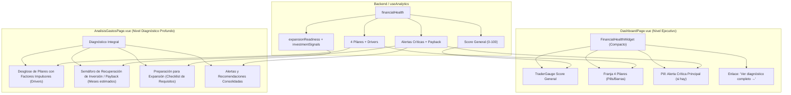

# Estrategia de Salud Financiera (Financial Health) — Frontend

**Estado:** Plan definido / Pendiente de implementación  
**Ámbito:** `DashboardPage.vue`, `AnalisisGastosPage.vue`, componentes `dashboard/` y `types/analytics.ts`  
**Objetivo:** Eliminar la duplicación entre Dashboard y Análisis de Gastos, crear un widget ejecutivo balanceado en Dashboard y aprovechar los datos ricos del backend (`expansionReadiness`, `investmentSignals`, payback) en Análisis.

---

## 1. Diagnóstico del Estado Actual

### Lo que está bien (Backend y Motor de Scoring)
- **Motor #10 en `AnalyticsServiceImpl.java`**: El backend implementa un scoring compuesto (0 a 100) balanceado en 4 pilares financieros:
  - **Rentabilidad (35%)**: Margen bruto (40%), operativo (35%) y neto (25%).
  - **Eficiencia (25%)**: Ratio de OpEx sobre ingresos.
  - **Estabilidad (25%)**: Concentración de proveedores (<50%) y estabilidad de precios.
  - **Crecimiento (15%)**: Tendencia trimestral de ingresos y rotación de inventario.
- **Señales Avanzadas**: Detección de costo diario vs ingreso (`DAILY_COST_CONTROL`), payback real de capital + deuda activa (`PAYBACK_RECOVERY`), señales de inversión y madurez para expansión.
- **Normalización**: `analyticsNormalize.ts` sanitiza y tipifica las respuestas del backend sin errores de runtime.

### Lo que está mal (Frontend)
1. **Duplicación Literal**:
   Tanto `DashboardPage.vue` como `AnalisisGastosPage.vue` renderizan exactamente el mismo componente:
   ```html
   <FinancialHealthPanel :data="financialHealth" :loading="analyticsLoading" :recommendations="supplierRecommendations" />
   ```
2. **Desbalance en `DashboardPage`**:
   `FinancialHealthPanel` incluye un medidor principal, guía de texto, 4 medidores secundarios, lista de alertas y lista de recomendaciones. En el Dashboard se ubica al lado de `CategoryBreakdownChart`, resultando en una columna desproporcionadamente alta que satura visualmente la pantalla inicial.
   > **Avance 2026-11-09**: el medidor (`TraderGauge`) pasó a mostrar las **zonas permanentes** en el arco (rojo 0-39 · amarillo 40-69 · verde 70-100) con aguja que las recorre; la fila de leyenda de bandas del panel se **eliminó** (menos altura, mismo significado). Con esto se reduce parte del desbalance descrito en este punto.

## Registro del rework de tacómetros (2026-11-09)

| Componente | Cambio | Motivo |
|---|---|---|
| `TraderGauge.vue` | `__fill` eliminado; `__bg` ahora conic-gradient de 3 zonas fijas (72°/126° = 40/70 puntos) | Las fronteras de zonas eran invisibles; se pierde info de proximidad al peligro. La leyenda de texto del panel era redundante y se borró |
| `OpexGauge.vue` | Token inexistente `--pq-chart-warning` → `--pq-warning`; marcadores 0/warning/critical/max alineados a la geometría del arco (`cos(π·r)`); transición muerta `stroke-dashoffset` eliminada; `shortcut:` nota de huérfano | El aviso amarillo no se dibujaba; las etiquetas caían corridas bajo un semicírculo |

Pendiente en `OpexGauge` si se reactiva con la sección Costo Operativo (fase 4c-3 de `FRONTEND_PENDIENTES_STRATEGY.md`): mostrar monto en B/. en el centro en vez de % (regla no-jerga), y confirmar proporción con datos reales.
3. **Datos Huérfanos del Backend (No Renderizados)**:
   El backend envía `expansionReadiness` (score, estado LISTO/EN_DESARROLLO/PREPARACIÓN, checklist de requisitos) e `investmentSignals` (colchón de deuda, apalancamiento, etc.). El frontend los recibe y normaliza, pero **ningún componente los muestra en pantalla**.
4. **Competencia de Alertas en `AnalisisGastosPage`**:
   En la misma pantalla conviven `FinancialHealthPanel` (que muestra alertas y recomendaciones) junto a `<AlertsPanel :items="enrichedAlerts" />` y `<SupplierRecommendationsCard :items="enrichedRecommendations" />`, repitiendo la información hasta 3 veces.

---

## 2. Nueva Arquitectura y Separación de Responsabilidades



---

## 3. Especificación de Componentes

### 3.1 `DashboardPage.vue` — Widget Ejecutivo Compacto
- **Objetivo**: Responder en 3 segundos: *"¿Cómo está la salud financiera general de mi empresa hoy?"*.
- **Comportamiento**:
  - Altura contenida para equiparar `CategoryBreakdownChart` (~380-420px).
  - Muestra:
    1. Medidor `TraderGauge` con el puntaje general (0-100) y etiqueta de banda ("Saludable", "En desarrollo", "Crítico").
    2. Resumen horizontal compacto de los 4 pilares (Rentabilidad, Eficiencia, Estabilidad, Crecimiento) con sus porcentajes y colores de estado.
    3. Alerta crítica principal: si existe una alerta (ej. *"Margen operativo negativo"* o *"Costo diario supera ingresos"*), se muestra como un badge destacado.
    4. Botón de texto al pie: *"Ver diagnóstico completo en Análisis →"*, con navegación directa a `/dashboard/analisis-gastos`.

### 3.2 `AnalisisGastosPage.vue` — Diagnóstico Profundo y Estratégico
- **Objetivo**: Responder: *"¿Por qué tengo este puntaje y qué acciones estratégicas debo tomar para crecer o proteger mi capital?"*.
- **Comportamiento**:
  - Mantiene el desglose detallado por pilar con sus factores conductores (*drivers*: % margen operativo, % opex ratio, % concentración de proveedor).
  - **Nueva Sección: Recuperación de Inversión (Payback)**:
    - Muestra los meses estimados para recuperar el capital propio invertido y la deuda activa (`PAYBACK_RECOVERY`).
  - **Nueva Sección: Preparación para Expansión (`expansionReadiness`)**:
    - Indicador de estado: `LISTO`, `EN_DESARROLLO` o `PREPARACIÓN`.
    - Checklist visual de requisitos cumplidos vs pendientes (rentabilidad sostenida 6+ meses, colchón de deuda <10% de ingresos, madurez de proveedores).
  - **Consolidación de Alertas**:
    - Integra las alertas críticas de salud financiera dentro de `AlertsPanel` para evitar duplicidad de bloques en la página.

---

## 4. Plan de Implementación por Pasos

1. **Paso 1 — Refactor del Widget de Dashboard**:
   - Ajustar `FinancialHealthPanel.vue` (o modo compacto vía prop `compact?: boolean`) para que cuando esté en `DashboardPage` no renderice las listas extensas de alertas ni recomendaciones, sino el resumen balanceado de pilares y enlace a análisis.
2. **Paso 2 — Incorporar Señales de Expansión y Payback en Análisis**:
   - Agregar el componente/sección de `expansionReadiness` e `investmentSignals` en `AnalisisGastosPage.vue` consumiendo los datos ya provistos por `useAnalytics()`.
3. **Paso 3 — Unificación de Alertas en Análisis**:
   - Consolidar las alertas de salud financiera en una sola lista junto con `enrichedAlerts`, evitando elementos repetidos.

---

## 5. Verificación y Criterios de Aceptación

```bash
# Linting
cd frontend/pymes && npm run lint

# Build de producción y typecheck
cd frontend/pymes && npm run build
```

### Pruebas Manuales
1. **Dashboard**:
   - La tarjeta de Salud Financiera tiene una altura visual simétrica respecto al gráfico de dona de categorías.
   - El enlace inferior redirige a `/dashboard/analisis-gastos`.
2. **Análisis de Gastos**:
   - Se visualizan las señales de expansión y requisitos calculados por el backend.
   - Las alertas y recomendaciones se presentan de forma clara y unificada sin repetirse.
